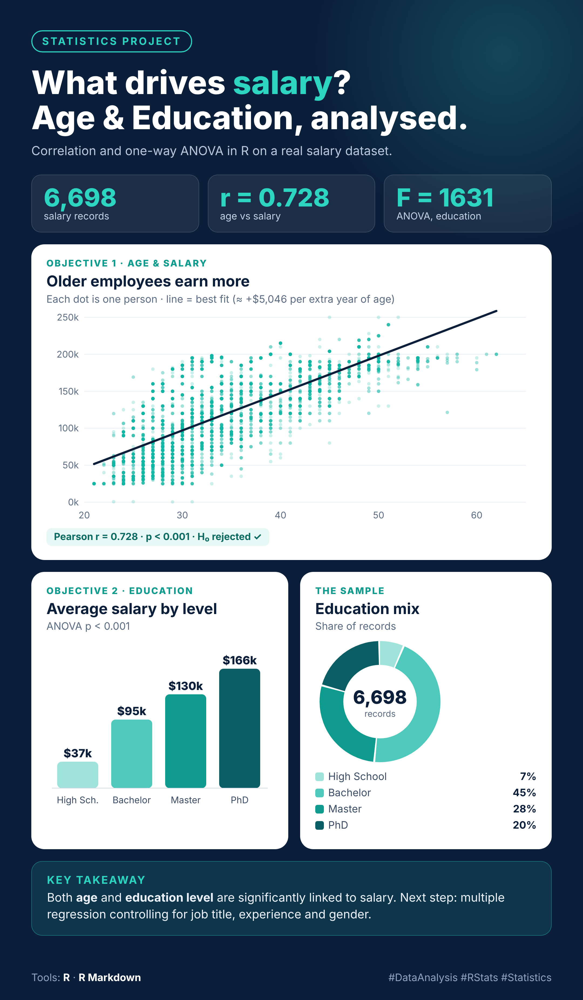

# Salary Data Analysis: Age, Education Level and Salary

## 📊 Project Overview

This project analyzes the relationship between **age, education level, and salary** using a real-world salary dataset.

The statistical analysis was conducted in **R** using Pearson correlation, one-way ANOVA, and Tukey HSD post-hoc analysis.

The dataset contains **6,703 employee records** with variables including Age, Gender, Education Level, Job Title, Years of Experience, and Salary.

## 🎯 Objectives

### Objective 1 — Age and Salary

To examine the correlation and pattern between **age and salary** using Pearson correlation.

### Objective 2 — Education Level and Salary

To examine whether **salary differs significantly across different education levels** using one-way ANOVA.

## 🔬 Statistical Methods

- Pearson Correlation
- One-way ANOVA
- Tukey HSD Post-hoc Test
- Data Cleaning and Preparation
- Data Visualization
- R Markdown

## 📈 Key Findings

### Age and Salary

A strong positive relationship was found between age and salary.

- **Pearson correlation (r): 0.728**
- **p-value: < 0.001**
- The null hypothesis was rejected.
- Salary tends to increase as age increases in this dataset.

Approximately **53% of the variation in salary is shared with age (r²)**.

### Education Level and Salary

A one-way ANOVA showed that mean salary differs significantly across education levels.

- **F(3, 6694) = 1631**
- **p-value: < 0.001**
- The null hypothesis was rejected.

Average salaries increased across education levels:

| Education Level | Average Salary |
|---|---:|
| High School | $36,707 |
| Bachelor | $95,083 |
| Master | $130,112 |
| PhD | $165,651 |

Tukey HSD post-hoc analysis found statistically significant differences between all education-level pairs.

## 📊 Project Visualization

The project includes an infographic summarizing the major statistical findings.

## 🛠️ Tools and Technologies

- **R**
- **R Markdown**
- **Statistical Analysis**
- **Pearson Correlation**
- **One-way ANOVA**
- **Tukey HSD**
- **Data Visualization**

## 📁 Project Files

- `Salary Data Cw 02.Rmd` — R Markdown analysis and statistical code
- `Salary Data Analysis - Age, Education Level and Salary.pdf` — Detailed analysis report
- `salary_infographic_v2.png` — Project results infographic

## 💡 Conclusion

The analysis found that both **age and education level are significantly associated with salary** in this dataset.

However, these findings represent associations rather than proof of causation. Age and education may be related to other factors such as work experience and job seniority.

Future analysis could use **multiple regression** to examine age, education, years of experience, gender, and job title together.

## 👩‍💻 Project Author

**Anuththara Subhasinha**

Statistical Analysis Project — R
